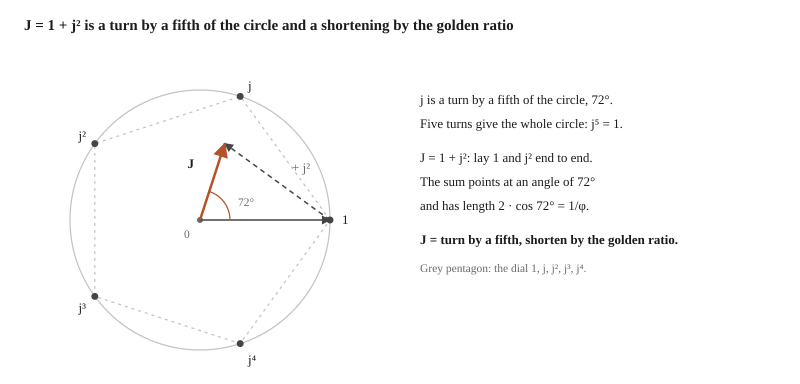
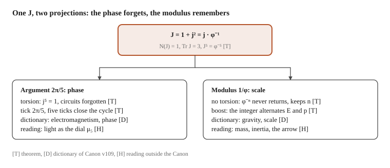
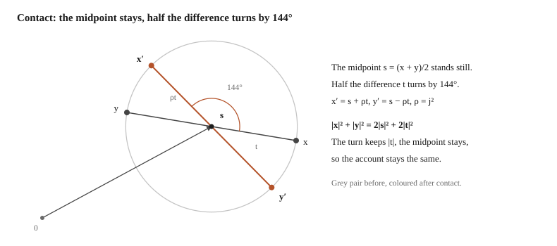

# The picture of physics according to TWIST-J, and what is still missing

Working document of the TWIST-J program, NON-CANONICAL. Translated from the Czech working original, which is not published; the translation is machine-made and synced automatically from the source document. Nothing here is stronger than the registry row it rests on.

Twist-J builds physics out of one number J = 1 + j² and one step. It reads space as the place where order matters. It reads time as the number of steps. Energy as an account that is conserved at contact. Matter as the part of the step that does not come back. Interaction as a contact of two slots whose rhythm is governed by divisibility by two. The mathematics under these readings is largely proved. That it is the physics of our world is not yet proved.

## How to read this

The document rests on Public Canon v109 (tag canon-v109). The registry has 609 claims: 465 T, 59 D, 40 C, 2 H, 24 O and 19 F. Live H and O rows number 26. Since v108 the rhythm of contact has four general theorems in the Canon, and the common contact instrument for two inputs is a theorem since v108. V109 added the renewal of the working core for any number of inputs fixed in advance. Further results on contact are outside the Canon: in NON-CANONICAL notes on public main, in the unmerged PRs #1857, #1862, #1865, #1867 and #1869, and in the working project.

Every sentence carries, in square brackets, how far to trust it:

- [T] theorem: proved, either directly from the axiom or in a precisely specified model.
- [D] dictionary: the Canon has agreed how to read a given piece of mathematics as physics. An agreement is not a proof.
- [C] computation: verified on finitely many cases.
- [H] hypothesis: a claim that a concrete measurement or computation can bring down.
- [O] open: we know exactly what has to be decided, and it is not decided.
- [candidate-T] and [candidate-C]: a proof, or a finite computation, outside the Canon, in the working project or in a draft PR. Only inclusion in the public Canon gives them a status, not a review and not agreeing computations.
- [reading]: an interpretation outside the Canon. It has at most the strength of a hypothesis.

Beware of the word model. Many theorems hold in a model that someone specified from outside. A theorem about the model is not yet a theorem about the world.

Which rule each thing comes from. The layers share one arithmetic, but their dynamical equivalence is not proved. Every result belongs to its layer:

| Layer | What it gives | What it does not establish |
| --- | --- | --- |
| Arithmetic of J | the integer step, the fifth-of-a-turn phase, golden scaling, the discrete ladder of boosts | that this boost changes measured space and time |
| The original rule U | an exactly analysed run and the limits of the steady dynamics | a lasting interaction derived from the run |
| Contact C and the chain F = C₂₃C₁₂ | conservation of accounts, gate switching, the classification of rhythms, limits of reading | a derivation of contact from U and a physical instrument |
| The Dirac step and small models | the mass shell, the ladder of energy and momentum, the walker's speed | that the same relations come out of the integer contact world |

The falsifier of the document: any sentence in it stronger than the row it rests on.

## The two guards the five

The world measured from inside, under a stroboscope. The author's reading of the contact law, version 3.

I think this is the important thing, more important than any single number. That three motions are enough, rotation, shrinking and stretching, one touch between neighbours and one coin, and out of it start to crawl time, energy, light, matter, space and finally memory too. Not as a metaphor. As equations that can be recomputed on paper. One example that is enough for paper is in the middle. How much of it is proved and how much is still only reading, I write in brackets beside each piece.

### Stroboscope

Between two ticks nothing happens. The world does not move smoothly, the world switches. The counter says which tick it is, and that is all we have about time at the start. It is a stroboscope: flash, dark, flash. A wheel that turns by two fifths between flashes you see jumping over five points. After the fifth flash it is back where it started.

The stroboscope sees points, not motion. And it sees them only when it flashes. That will matter for chance.

### The arrow and the golden ratio inside out

Values in the model are arrows in the plane. Multiplying by the number j turns an arrow by a fifth of the circle; five turns are the whole circle. The number J is something else: take an arrow, turn a copy of it by two fifths and add the two. Out comes a shorter arrow, 1/φ of the original length, turned by a fifth. φ is the golden ratio, so J is the golden ratio inside out, the ratio of a pentagon's side to its diagonal. [T]

$$
J = 1 + j^2 = \frac{j}{\varphi},\qquad j^5 = 1,\qquad J^5 = \varphi^{-5}.
$$

Multiplying by J turns and shrinks at the same time. After five steps the arrow points where it did at the start, only shorter. And now the essential part. You can walk the five points on the circle neighbour by neighbour, as a pentagon, or skipping one, as a pentagram. The same five points, two orders. In one reading J shortens the arrow, in the other it lengthens it, by a factor of φ. The model does not say which reading is ours. It turns in both; shrinking or stretching is a choice nobody has made for us. [T] This undecidability is the smallest possible bit. [reading] Hence the proposal to read gravity in the change of scale and electromagnetism in the turning. [D]

### Touch

Two neighbouring slots, each holding one arrow, x and y. They touch only when they are in step: the difference of their arrows must be divisible by two. That is decided by the state of both slots, not of one. If yes, the sum of the two arrows stays and the difference turns by two fifths. If not, both stand still. [T]

$$
x' = \frac{J\,x + (2-J)\,y}{2},\qquad y' = \frac{(2-J)\,x + J\,y}{2},\qquad \left(x \equiv y \pmod 2\right) .
$$

The two in the denominator is the coin. The numerator can be divided by two exactly when the difference is even, because Jx + (2−J)y = J(x−y) + 2y and J has an inverse in the integers of the model. The gate and the rule are one equation. The two guards the five: parity decides whether the rotation happens at all. The dictionary of the Canon divides the work the same way: the five writes, the two reads. [D]

An example for paper. Put (2, 0) on two slots. After n undisturbed touches there is exactly

$$
(x_n,\;y_n) = \left(1 + j^{2n},\; 1 - j^{2n}\right).
$$

After the first touch (J, 2 − J). After the fifth (2, 0) again, the neighbour is empty. [T] Almost everything that follows can be seen in this single example.

### Diagonal and twist

The same in other words. Instead of x and y follow their sum s and their difference d. Then the touch is transparent. [T]

$$
s' = s,\qquad d' = j^2\, d .
$$

The sum holds. The difference turns. Whoever knows the picture of “how the components of a tensor transform” recognises it: the matrix of the touch has the trace on the diagonal and the twist off it, and the basis of sum and difference is exactly the one turned by 45°.

$$
C = \frac12\begin{pmatrix} J & 2-J\\ 2-J & J\end{pmatrix},\qquad \operatorname{tr} C = J,\qquad \det C = j^2 .
$$

J is the trace of the touch, j² its determinant. But careful with that trace. Five touches are the identity, so the trace of five touches is 2, whereas the fifth power of the trace of one touch is φ⁻⁵. The trace does not multiply. [T]

$$
C^5 = I,\qquad \operatorname{tr}\left(C^5\right) = 2,\qquad \left(\operatorname{tr} C\right)^5 = \varphi^{-5}.
$$

So the touch by itself never shrinks the pair as a whole. J sits in it only as the sum of two eigenvalues, 1 and j², and both have length one.

### Energy

The touch lengthens and shortens the individual arrows; from (2, 0) it makes (J, 2 − J). But it leaves the lengths of the sum and of the difference. The sum of the squared lengths of the two arrows therefore does not move, and it does not move separately for the sum and separately for the difference. [T]

$$
|x'|^2+|y'|^2 = |x|^2+|y|^2 = \frac{|s|^2+|d|^2}{2}.
$$

That is the budget. Half the square of the sum belongs to the motion of the whole, half the square of the difference to the inner turning. On the example (2, 0) → (J, 2 − J) the budget can be recomputed in two ways and both are exact. A reader of squared lengths in a single complex plane shows the shares

$$
\left|\frac J2\right|^2 = \frac{3-\sqrt5}{8},\qquad \left|\frac{2-J}{2}\right|^2 = \frac{5+\sqrt5}{8}.
$$

The integer account adds the squares over both conjugate planes, that is over both readings, the pentagon and the pentagram. It splits the same deposit of eight units into 3 and 5:

$$
\operatorname{Tr}|J|^2 = \varphi^{-2} + \varphi^{2} = 3,\qquad \operatorname{Tr}|2-J|^2 = (2+\varphi) + (3-\varphi) = 5,\qquad \operatorname{Tr}|2|^2 = 4 + 4 = 8 .
$$

Two accounts, one deposit. [T] The square root of five cancels in the sum of the two readings. The difference between the accounts is that bit from above: the first already knows which plane it stands in, the second need not know it, and that is why it comes out in integers. [reading] Which account measures energy and which predicts the frequency of hits cannot be chosen by which one we like better. The instrument and its physical reading must decide that. [O]

### Time

The counter only counts. A clock needs something that returns. The smallest clock is a pair in touch: its difference turns by two fifths every tick and is back after five ticks. [T]

$$
d_n = j^{2n} d_0,\qquad d_5 = d_0 .
$$

For the pair alone the tick and the position of the hand coincide. In a larger machine they no longer do. Take three slots (4, 0, 2) and for one tick the left touch and after it the right one. The state in which both differences are even returns every five ticks, the whole state only after 25. Five equal marks, five different phases. [T] Whoever sees only the mark has a clock with period five and knows nothing of the phase. The Canon also has a pair of states with the same accounts, the same sum and the same whole history of marks, and yet one returns after five ticks and the other after 25. [T] That is why the counter and the clock stay two things and time is not one number. It is a counter plus a hand.

### Chance

The stroboscope a second time. The wheel turns exactly, two fifths per tick. Flash every fifth tick and you see a single position. Flash every second one and you see all five positions equally often. Flash irregularly, at ticks 5k² + 1, and you always see the same position. [T] The wheel did not change once. What changed is when you read it off.

$$
5k^2 + 1 \equiv 1 \pmod 5 .
$$

So frequency is not a property of the wheel. It is a property of the pair wheel and readout. Whoever does not know the phase must also know when his instrument takes its readings. A proposal for what chance is: a deterministic clock plus a schedule of readouts that does not keep step with it. [H] We pay for chance with time in this sense: whoever pays the ticks and aligns the readout with the wheel sees no chance. Here the hypothesis can be tested. The falsifier: an instrument that knows the phase and reads in step with the wheel, and still sees a spread. In the model that cannot happen. In nature an experiment will decide, once it is clear what the phase is there.

Bell's inequalities bound it. The hidden phase is a hidden variable, and the schedule of readouts, that is when and how the instrument reads, is its setting. When the outcome at one slot depends only on the phase and on the schedule there, and the schedule is chosen independently of the phase, experiments with Bell's inequalities refute such chance. The hypothesis must therefore be nonlocal, or it must tie the schedule to the phase. Which way to go is open. [O]

And the model offers the first numbers right away: they are the two accounts from the example (2, 0). If the square of the length is read as a frequency, which is the Born rule and in the program a candidate for the passage between relation and event, the first account gives the shares (3−√5)/8 and (5+√5)/8, the second 3/8 and 5/8. [T for the numbers] The Canon so far has the Born rule only as a chosen dictionary in one chain of measurement, not derived. [D] Which of the accounts a real instrument writes, and what the readout leaves behind, is not derived. [O]

### Light

Every touch is a pure rotation. It never changes the length of the pair as a whole; it turns the difference by two fifths and nothing more. Hence the proposal to read electromagnetism in the turning of phase. [D] Shrinking does not act in the touch at all. J is only the trace there, and the trace does not multiply; five touches are the identity. The step “multiply by J”, which shortens the arrow, is another operation. Whether shrinking emerges from many touches and gates by coarse-graining, or is a separate rule, is open. [O] Here is the hole between light and gravity.

### Matter

A body is a process that holds together even when it moves as a whole. [reading] The smallest such process is a pair in touch. The sum stands, that is the centre of mass. The length of the difference stands, that is the bond. The phase of the difference runs, that is the internal clock. The energy of the bond is locked in the turning on the spot, that is rest energy: matter is energy that circles and goes nowhere.

A lone pair does not let go: once an even difference, always an even difference. [T] A third slot can break it. On the triple (4, 0, 2) both differences are even. The left touch goes through and the right one right after it changes the parity of the middle slot, so the left difference stops being even. [T] It is the same triple as for the clock: both differences are even only every fifth tick, in between at least one bond is broken. So a bond is not a thing. It is a state of the neighbourhood.

And the price. A pair holds two slots, but a third slot does not always break it. It is decided at the moment of the touch, not before it. After the left touch the middle slot has a new arrow y'. The right touch goes through when the third slot is in step with it, that is congruent modulo 2. It leaves the bond only when it is congruent one floor deeper too, modulo 4; then it merely exchanges part of the budget with the pair. When it is congruent only modulo 2, it breaks the bond. [T]

$$
x' - y'' \equiv J\cdot\frac{z - y'}{2} \pmod 2 .
$$

On (4, 0, 2) it breaks. On (4, 0, 4) it breaks too, even though the third slot was congruent with the middle one modulo 4 before the touch; after the left touch it no longer is. On (8, 0, 0) it goes through and the bond holds. A slot with a bound pair may be shared only by one who is in step with it one floor deeper as well, and at the moment of touching. For matter we perhaps pay with space, more precisely with that extra floor. [reading]

What can be measured: in another model, where the bound pair can also propagate, model W in the Canon, the mean velocity of its centre after a weak kick gives the response mass, in units of the model. [T in the given model]

$$
\frac{\bar v}{\Delta P} \;\longrightarrow\; \frac{\sqrt{16\varphi+7}}{20},\qquad m = \frac{20}{\sqrt{16\varphi+7}} .
$$

It becomes a number about nature once the decoder determines which real pair it is, and what the unit of length and time is. The electron mass gives one anchor. [O]

### Space

Three slots, two touches, left and right. Now the order matters, but only when the gates let through. Both orders pass both touches exactly when all three arrows are equal modulo 4. The proof is short: the first touch of each order wants agreement modulo 2, the second wants J times half the difference to be even, and J is a unit modulo 2, so the difference must be divisible by four. [T, proof in the text; no row of its own in the registry] The order can even decide the gate itself: on the triple (0, 2, 2 + J) the right touch goes through only if the left one ran before it. [T] On the triple (0, 1, 0) both gates stay closed and the difference of the orders is zero. On the triple (4, 0, 0) not:

Left, then right:

$$
(4,0,0) \to (2J,\; 4-2J,\; 0) \to \left(2J,\; 2J - J^2,\; (1-j^2)^2\right)
$$

Right, then left:

$$
(4,0,0) \to (4,0,0) \to (2J,\; 4-2J,\; 0)
$$

The third slot ends once with (1 − j²)², the other time with zero. The sum is 4 in both cases. The third slot can tell in which order the touches happened. A reader of the sum cannot. [T] The measuring device is part of the picture of the world here: what can be told apart depends on which slot reads.

With open gates the difference of the two orders is linear and comes out exactly, with a plus sign; v is the triple of arrows: [T]

$$
[C_{12},C_{23}]\,v = +\left(\frac{2-J}{2}\right)^2 (1,1,1)\times v .
$$

It is a vector product with the axis (1, 1, 1). In ordinary space such a product generates rotation about that axis, here about the direction in which the total sum is held. The size is the twist squared, the off-diagonal term of the touch. With a closed gate the formula does not hold; that is the example (0, 1, 0): the left side zero, the right side not.

Space here is not a box that things are put into. Space is what arises when it matters what happened earlier, and when a third is present who writes it down. A shift is the difference of two orders. [D] In the core of the Canon the spatial reading is tied to another pair of operations, a and c. [D] This three-point example is a laboratory, not the Canon.

### What a touch does not change

The account of a slot, the integer one from Energy, can be written directly from the coordinates of the arrow in the basis 1, j, j², j³:

$$
Q(x) = \tfrac12 \operatorname{Tr}_{K/\mathbb Q}\left(x\bar x\right) = \frac{5\sum a_i^2 - \left(\sum a_i\right)^2}{2}.
$$

The half matters: the trace runs over all four embeddings. Besides its arrow every slot also has a mark: the residue r = x mod λ, where λ = 1 − j is the prime above five. It is one number from 0 to 4, the sum of the coordinates modulo five. And the touch never changes it. The rule gives x' − x = (1 − j²)(y − x)/2 and 1 − j² = λ(1 + j), so x' ≡ x mod λ, and likewise y' ≡ y. [T]

$$
x' - x = \lambda\,(1+j)\,\frac{y-x}{2},\qquad x' \equiv x \pmod{\lambda}.
$$

Because 1 + j is a unit, the change of an arrow can be any element of λZ[j], given a suitable neighbour. So the mark captures exactly everything that must stay the same on one arrow under every possible touch, and nothing more. In this exact arithmetic sense it is a local charge, and everything that flows is neutral. [T] Whether it has anything to do with electric charge is open. [O]

The mark governs the account too. From the coordinate formula follows Q(x) ≡ 2r² mod 5, and every mark has its own smallest possible account:

| mark r | Q mod 5 | smallest account | where |
| --- | --- | --- | --- |
| 0 | 0 | 0 | x = 0 (otherwise at least 5, e.g. x = λ) |
| ±1 | 2 | 2 | x = ±1 |
| ±2 | 3 | 3 | x = ±(1 + j), also ±J |

So only a slot with mark zero has an account that is a multiple of five. And from the account of a single slot one can read which quadratic class its nonzero mark belongs to: residue 2 means χ₅(r) = +1, residue 3 means χ₅(r) = −1. The account does not tell the mark r from −r. That is the Legendre bit, this time read from one slot. [T]

The five is exact as the size of a transfer too. Take any integer k and the pair (k + 1, k − 1). The difference is two, the gate opens every time and a single touch makes

$$
(k+1,\;k-1)\longmapsto\left(k+j^2,\;k-j^2\right),\qquad \left(\Delta Q_1,\;\Delta Q_2\right)=(-5k,\;+5k).
$$

Every multiple of five can pass in a single touch. The pair (2, 0) makes the smallest nonzero transfer: from the accounts (8, 0) it makes (3, 5), and the first slot is left with exactly the minimum for its mark 2. [T]

Six such contact slots have six constant marks. The original six-tuple of the kernel follows another rule and changes at the tick; the contact law is a narrower thing. [T, scope of the contact law]

Briefly, for the picture: an empty slot can carry five units of account after a touch and still have charge zero. Its neighbour handed it part of its account. Both slots kept their marks. The two guards whether the touch happens. The five sets by how much the account can move. And precisely in how much went where, a record can remain. [T in the contact model]

### Record

Go back to (4, 0, 0). Nobody needs to count flashes to tell later in which order the touches happened. The order is not in the counter. It is stored in a slot. Memory is a commutator that was left lying. A reader of the sum does not see it, because the sum is exactly what the touch protects. Only someone who looks at the slot where nothing should have been sees it. And that slot keeps its mark zero: a new record arises without its mark changing. That is why the account of a record is always a multiple of five.

And a record is not free. The integer account gives the deposit (4, 0, 0) thirty-two units. After the order left, right they are split into 12, 5 and 15. After the order right, left into 12, 20 and 0. [T]

$$
32 = 12 + 5 + 15,\qquad 32 = 12 + 20 + 0 .
$$

The record of the order on the third slot weighs 15 out of 32 and took them from the middle slot, which dropped from 20 to 5. The sum holds. But the fact that someone remembers cost moving almost half the deposit to the one who remembers. For memory we pay with energy. [reading] The Canon has the general price computed: in the contact alphabet every retained output costs at least four slots and 12 units of account. [T]

Here mathematics becomes physics. Everything before was accounts that we choose: which plane, which square, when to flash. This the machine wrote by itself. Zero, or nonzero on the third slot, without knowing the phase and without a schedule of readouts. It is the first datum in the whole text that an instrument can leave without our telling it how to read. So what to look at in an experiment: not the sum, which is conserved and blind. At the third one, who should have stayed empty and did not. [reading] Whether one can derive from such a record also which outcome is written and how often, that is whether this gets around at least part of the port, is open. [O]

### What it costs

Three motions, one touch, one coin. Time is the hand of the pair plus the counter. Energy is the sum of squares, in two accounts. Light is the rotation of the difference. Matter is a pair that does not let go until someone breaks it. Space is the difference of two orders, seen by the third slot. The mark of a slot does not change, the account moves in fives. Memory is the third slot where that difference was left lying. For chance we pay with time, more precisely with the schedule of readouts. For matter perhaps with space, more precisely with the floor of agreement with the neighbours. For memory with energy. Whether that is the price of a bit, I do not know.

An instrument that reads, writes and renews itself on one carrier the Canon has for two inputs since v108, and since v109 for any number of inputs fixed in advance. [T] The working core returns to readiness after every input, the records remain: every input leaves two permanent archives behind. What the machine does not yet give is the port out: which account the instrument writes, which outcome and how often, and what the model unit of length and time is. [O] And the schedule by which it reads we still supply from outside. Until that is there, all the numbers above are about the machine. They will start to speak about nature only with the port.

Marks in this section: [T] proof in the given model, [D] physical reading, that is a dictionary with no claim to uniqueness, [H] hypothesis with a falsifier, [O] open, [reading] interpretation with no claim to proof. T and D rest on a registry row or on a proof right in the text; H and reading are not in the registry.

References, Public Canon v109, canon/REGISTRY.tsv: the contact law and the parity gate RELATIVE-CONTACT-INTEGRAL-LAW; the rhythm RELATIVE-CONTACT-RHYTHM-CLASSIFICATION; the hidden fivefold phase and the pair of states with periods five and 25 RELATIVE-CONTACT-RHYTHM-FIVEFOLD-PHASE; the response mass in model W CONTACT-W-BOUND-PAIR-RESPONSE; the price of a record RELATIVE-CONTACT-RETAINED-BANK-CAPACITY; the instrument for two inputs RELATIVE-CONTACT-COMMON-APPARATUS-OPEN and for k inputs RELATIVE-CONTACT-FINITE-WORKBANK-REUSE; all T. The accounts of the triple (4, 0, 0) are computed in the proof of the contact law, notes/C-J-INTEGRAL-RELATIVE-CONTACT-N/PROOF.md, section 7. The half-trace canon/CANON.md lines 13544 to 13562, the scope of the contact law lines 13616 to 13635; the Legendre bit from one slot is a proof in the text. The dictionary AXIOM-PROJECTION-DICTIONARY, the spatial reading on the pair a, c TIME-CUT-READING and the Born rule QDD-SELECTED-BORN are D. The three-point commutator formula and the modulo 4 criterion as a general theorem have no row of their own.

## One number J

The whole program stands on one number. To understand it, three things from secondary school suffice.

A complex number is an arrow in the plane. It has a length and an angle. You multiply two arrows by adding the angles and multiplying the lengths. You add them by laying them end to end.

The number j is an arrow of length 1 at an angle of 72°, a fifth of the circle. Five such turns give the whole circle, hence j⁵ = 1. The arrows 1, j, j², j³, j⁴ point to the vertices of a regular pentagon. It is a dial with five positions.

The golden ratio φ = (1 + √5)/2 is the number for which φ² = φ + 1. Its reciprocal is 1/φ = φ − 1.

The axiom reads J = 1 + j². Lay the arrow 1 and the arrow j², which points at an angle of 144°, end to end. The sum of two unit arrows lies exactly on the axis between them:

$$
1 + e^{i\theta} = e^{i\theta/2}\left(e^{-i\theta/2} + e^{i\theta/2}\right) = 2\cos\tfrac{\theta}{2}\; e^{i\theta/2}
$$

For θ = 144° J has angle 72° and length 2 · cos 72°. Since cos 72° = (√5 − 1)/4, we get 2 · cos 72° = 1/φ. So J = j · (1/φ): turn by a fifth of the circle and shorten by the golden ratio. [T, J-PROJECTIONS]



But J needs neither cosines nor square roots. Every number z = a + bj + cj² + dj³ with integers a, b, c, d is a quadruple (a, b, c, d). The step "multiply by J" is a purely integer table. [T, arithmetic of the axiom]

$$
(a,\, b,\, c,\, d) \;\mapsto\; (a - c + d,\; b - c,\; a,\; b - c + d)
$$

Integers in, integers out. Length and angle are just two readings of the same step.

The equation x⁵ = 1 is satisfied, besides one and j, by three more arrows: j², j³ and j⁴. Substitute them for j and you get four views of the same number. Mathematics calls them Galois embeddings. In those four views J has lengths 1/φ, φ, φ and 1/φ. Their product is 1, hence N(J) = 1. [T] In one view J shortens, in another it lengthens by the same ratio. That is exactly the shape of a Lorentz boost from the theory of relativity. [boost as reading: D, BOOST-COUNT-LADDER]

The two readings of J are not symmetric. The angle returns after five steps, so it does not remember how many times it went round the circle. The length never returns: after n steps it is (1/φ)ⁿ and you can read n off it. Hence J⁵ = φ⁻⁵: five steps bring the angle back to the start and shorten the length five times by the golden ratio. The angle forgets, the length remembers. [T]

The Canon has a dictionary for this: length is gravity and scale, angle is electromagnetism and phase. [D, AXIOM-PROJECTION-DICTIONARY]



In the program the world is a closed integer plenum, a full stage with no void. That is a postulate, not a theorem.

## Space

Space is the place where order matters. In ordinary arithmetic order does not matter: 2 · 3 = 3 · 2. For motions it does. Putting on shoes and then socks is not the same as the other way round. Mathematics calls the difference between two orders a commutator.

Take five positions 0, 1, 2, 3, 4 on a circle and two motions. The motion X shifts everything one position along. The motion Z leaves position k in place and turns its phase by jᵏ, by k fifths of the circle. First Z and then X gives jᵏ at position k + 1. First X and then Z gives jᵏ⁺¹ at the same position:

$$
XZ\,e_k = j^{k}\, e_{k+1}, \qquad ZX\,e_k = j^{k+1}\, e_{k+1} \quad\Longrightarrow\quad ZX = j\, XZ
$$

The difference of orders is the same at all five positions, exactly one fifth of the circle: ZXZ⁻¹X⁻¹ = j · I. [T, FORCE-WEYL-HOLONOMY] Reading this mismatch as the curvature of a force is dictionary. [D, FORCE-AS-CURVATURE]

A cell with a five. Take a digon, a face with two edges, and a triangle. Glue them along one edge. Among two-faced cells with faces of one to three edges, the pair (2, 3) is the only one whose modes return exactly after five steps. The mode k = 1 has the shape of J: the ratio of amplitudes, triangle to digon, is 1/φ and the angle is 72°. It comes with a right triangle with legs |1 − j| and φ and hypotenuse 2. You can check Pythagoras yourself: |1 − j|² = 3 − φ and (3 − φ) + φ² = 3 − φ + φ + 1 = 4. The smaller cell (1, 2) has order 10 and reads rotated copies of J. [probe P-DIGON-TRIANGLE-J-MODE-1 passed on two architectures; PR #1733 not merged, no registry row]

What the steady run lacks. After a short start-up the original rule U uses only the three letters b, d, e. Their order mismatch is always just a shift: the derived group is exactly 25 shifts. [T, FIRED-COMMUTATOR-NOGO] Spatial noncommutativity must therefore come from somewhere other than the steady run of U. [reading]

Three dimensions. The Canon carries a three-dimensional lattice D3: points (x₁, x₂, x₃) with integer coordinates and even sum. It is the same lattice in which the atoms of copper sit, face-centred cubic. In the Canon it is a dictionary for the photon, not a theorem derived from J. [D, PHOTON-SPATIAL-TEMPORAL-TRANSFER] The reading that two spatial directions are phase directions (±i) and the third axis is frozen time remains a working one. [reading]

## Time

Time is the counting of steps. The world makes step after step and the counter n says how many have passed. Identifying n with physical time is dictionary, not a consequence of the machine. [D, TIME-CUT-READING]

One tick is a fifth of a turn, the angle 2π/5 = 72°. Five ticks close a full cycle. [T, METRO-TICK]

Which of the five possible steps the world makes at tick n is governed by a single bit θₙ of the Thue-Morse sequence. It is easy to compute. Write n in binary and see whether it has an even (θ = 0) or an odd (θ = 1) number of ones:

```text
n   0 1 2 3 4 5 6 7 8 9 10 11 12 13 14 15
θ   0 1 1 0 1 0 0 1 1 0  0  1  0  1  1  0
```

The rule for choosing the letter is i = (z₅ + 2θₙ) mod 5, where z₅ is the state of one register. [D, TIME-CUT-READING] The sequence is not periodic and no segment of it occurs three times in a row. [T, known theorem on Thue-Morse]

A short past fixes the phase. Whoever sees the last 5 · 2ᵏ⁻¹ bits knows the phase modulo 2ᵏ, even without an absolute clock. For k = 3, 20 bits suffice and the phase is known modulo 8. [T, U-FINITE-HISTORY-CLOCK-PHASE]

A sixty-step clock inside J. You know counting modulo from the clock: 13 o'clock is 1 in the afternoon. The same works with the numbers a + bj + cj² + dj³. Modulo 2, J returns to the start after 15 steps. Modulo (1 − j), j behaves like 1, so J = 1 + j² behaves like 2. The powers of two modulo 5 go 2, 4, 3, 1 and return after 4 steps. Together J returns after the least common multiple of 15 and 4, after 60 steps. On the way it passes through a single cycle of all 60 classes that have an inverse. [T, algebra, recomputed] Inside the sixty hide smaller clocks of 3, 4 and 5 steps.

Without a clock the world is a mirror. Whoever reads only the six registers and has no counter sees, on the steady sheet, a law that is back at the start after two steps: V²D = D. Every law of odd order, say a cycle of three, collapses for them into standing still. [candidate-T, cathedral build 1]

An honest coin costs a clock. A fixed reader with finite memory and no counter cannot manufacture independent coin tosses at all block lengths out of U. With access to the counter any sequence can be made. [T, U-FINITE-READER-INDEPENDENCE-OBSTRUCTION]

The arrow of time. The step J can be exactly undone in integers, because N(J) = 1 and J has an integer inverse. [T] So the arrow does not sit in the irreversibility of the step. The working reading puts it in the length: (1/φ)ⁿ shrinks in one direction and never returns to any earlier value. [reading]

## Energy

In the program energy is so far an account, not a derived physical quantity. The account is exactly conserved at contact. The Canon does not, however, claim that it is the energy we measure. [T, RELATIVE-CONTACT-INTEGRAL-LAW; the identification with energy is outside the scope of the row]

A contact of two slots. Two slots hold the numbers x and y. The contact keeps their sum and turns half the difference t = (x − y)/2 by 144°, multiplying it by ρ = j². With the midpoint s = (x + y)/2:

$$
x' = s + \rho\, t, \qquad y' = s - \rho\, t, \qquad \rho = j^2
$$

In integers this works exactly when x − y is divisible by two. Otherwise the contact does not happen and the pair stays as it is. This is called a refusal. That a refused pair stays unchanged is a choice of the model, not a theorem. Five contacts in a row bring everything back to the start, because ρ⁵ = 1. [T, RELATIVE-CONTACT-INTEGRAL-LAW]

Why does the account not change? It is the parallelogram law from school geometry:

$$
|x|^2 + |y|^2 = 2\,|s|^2 + 2\,|t|^2
$$

The contact does not move the midpoint s and the turn does not change the length of t. So the right-hand side does not change, and neither does the left. [T]



The account of one slot. For z = a + bj + cj² + dj³ the account is an integer:

$$
q(z) = \frac{5\,(a^2 + b^2 + c^2 + d^2) - (a + b + c + d)^2}{2}
$$

It is half the sum of |z|² over all four views of z. For z ≠ 0 it is always positive. The smallest nonzero value is 2 and it is taken exactly by the numbers ±1, ±j, ±j², ±j³, ±j⁴. Those are the five vertices of the dial with both signs. [T, elementary, recomputed; formula from the proof of probe P-RELATIVE-CONTACT-FOUR-SLOT-MINIMUM-1]

Why not one? By the formula 2q = 5(a² + b² + c² + d²) − (a + b + c + d)². For q = 1 the square of the sum would have to leave remainder 3 on division by five. But squares leave only the remainders 0, 1 and 4. So there is nothing below two. Reading the two as a quantum of energy is interpretation. [reading]

The residue the contact does not see. Put j = 1 and count modulo 5: z gives the residue a + b + c + d mod 5. The contact changes x and y only by multiples of (1 − j), so the residue of each slot stays. The contact pours the account around, but it only moves residues about. [T, RELATIVE-CONTACT-INTEGRAL-LAW] A fixed sequence of contacts and swaps therefore only rearranges the residues, the same way for every input. [T, RELATIVE-CONTACT-FIXED-WORD-RESIDUE-BOUNDARY]

A record costs readiness. The task: split a six from one slot into four threes, 6 → 3, 3, 3, 3. The lengths fit, because 6² = 4 · 3². The residues do not: the six has residue 1, the threes residue 3. The contact does not manufacture residues, so an auxiliary bank of four slots has to bring them. The cheapest such bank has account 27. With a sign, 6 → −3, 3, 3, 3, account 12 suffices. [T, RELATIVE-CONTACT-FOUR-SLOT-MINIMUM]

For N separated known inputs and N retained results the bank needs at least 4N slots and an account of at least 12N. As long as the result lasts, the bank does not return to its original state. Reversing the whole procedure returns the bank, but the result disappears. [T, RELATIVE-CONTACT-RETAINED-BANK-CAPACITY] So the conserved account is not consumed. What is consumed is readiness, an ordered supply of residues. Whoever wants a record pays in readiness. [reading]

Energy as an angle. For a given contact step W there is a bounded generator H with exp(−iH) = W and its spectrum has two gaps. [T, CONTACT-W-SPECTRAL-READING] An eigenstate only turns in one step, and the angle of that turn is read as energy. [reading] But W is given from outside, not derived from U.

Where to get contact in the original U? Nowhere in the steady run. The only coupling between coordinates in U is the shear in the letter c. From every state U reaches the steady sheet within 9 ticks at most, and c fires at most seven times, then never again. [candidate-T, census of the transient phase] In U, interaction is preparation, not a lasting process. [reading] The total energy of the plenum, zero say, does not figure in the registry as a claim.

Carry in the original U. V109 added three theorems on the first tick of the original U and on the carry. The actual first receiver gives exactly s = q + r + 2, and among affine maps it is the only possibility; no nonempty common clock word of bits makes that port double, s ↦ 2s. [T, U-FIRST-TICK-AFFINE-TRACE-TRANSFER] The carries of two mutually inverse two-digit multiplications pair exactly, and the signs of the quadratic character on them are set by χ(2) = −1. [T, J-MARKED-CARRY-MIRROR] A reader of the carry modulo λ² tells J from J⁻¹ without any further datum, a reader modulo λ does not. [T, J-FIXED-INPUT-CARRY-PRECISION] A finite circuit on 62 cells carries this out for all 500 admissible preparations. [C, U-CARRY-MIRROR-FINITE-CIRCUIT] The contact carrier and the native carrier keep separate laws and interfaces.

## The rhythm of contact

Three slots in a row and two contacts give the first picture of interaction in time. Rhythm, event and measurement are all governed by one thing: how many times the difference of neighbours can be divided by two. [T for the rhythm, RELATIVE-CONTACT-RHYTHM-CLASSIFICATION; for event and measurement candidate-T]

The model. Take three slots with numbers a, b, c. One tick is F: first the contact of a with b, then the contact of b with c. The contact is the law from the section Energy, the order is given from outside. [model] The sum S = a + b + c is conserved, so is the account E = q(a) + q(b) + q(c) and the difference account M = q(a − b) + q(b − c) + q(a − c). On every account level there are only finitely many states and the step can be undone. Every orbit is therefore a closed circle. [T, RELATIVE-CONTACT-RHYTHM-CLASSIFICATION]

Depth. The number z₀ + z₁j + z₂j² + z₃j³ is even when all four coefficients are even. The gate of a contact asks whether the difference of neighbours is even. The depth d of a state says how many times both neighbour differences can be divided by two at once. Along an orbit the depth changes and its largest value decides.

A refusal is a pentagon one floor down. Double the whole state. A contact that was refused is now accepted. Its pair turns five times before it returns, and the neighbour refuses four times meanwhile. One tick with r refusals becomes 1 + 4r ticks:

$$
F^{\,1+4r(y)}(2y) = 2F(y), \qquad P' = P + 4R, \qquad R' = 4R
$$

Here P is the period of the orbit and R the number of refusals per period. [T, RELATIVE-CONTACT-RHYTHM-CLASSIFICATION; C on 88 075 triples and on all pairs of neighbour differences with M ≤ 64] What looks like "nothing happened" on the coarse scale is a whole circuit one floor down. [reading]

Three classes. Every orbit, except the complete agreement of all three slots, belongs to one of three classes. The largest depth d decides, and the shape that remains after d divisions by two. With the shorthand

$$
A(d) = \frac{4^{d+1}-1}{3}
$$

we get:

| Class | What remains after division | Period P | d = 0 | d = 1 | d = 2 | d = 3 | Smallest M |
| --- | --- | --- | --- | --- | --- | --- | --- |
| I | one contact refuses, the neighbours of the other agree | A(d) | 1 | 5 | 21 | 85 | 4 · 4ᵈ |
| II | both contacts refuse | 2A(d) − 1 | 1 | 9 | 41 | 169 | 4 · 4ᵈ |
| III | one pair turns, the other contact refuses | 5A(d) | 5 | 25 | 105 | 425 | 12 · 4ᵈ |

[T, RELATIVE-CONTACT-RHYTHM-CLASSIFICATION; smallest M: T, RELATIVE-CONTACT-RHYTHM-ACCOUNT-BOUNDS] Periods 13, 17 and 37 do not exist.

Interaction. An orbit interacts when some gate on it opens at one time and closes at another. Such orbits have period P = 4D + 5, where D is the number of ticks in which both contacts happen. The period is therefore at least 9 and never divides 10. [candidate-T]

The clock of U gives no interaction. Fixed blocks of the steady U have an order dividing 10. An exact reading without a counter that turns such a block into a tick of the chain reaches no interacting orbit. An exact reading of one step of U on the whole state space, including the transient letter c, sees only the fixed points of the chain. [candidate-T, C-GATE-RHYTHM-NATIVE-CLOCK-1]

The step J does not change the rhythm. Multiply the whole state by J, by φ or by any number that is not even. The gates decide the same way and the orbit goes step by step the same, only multiplied. So the contact commutes with the step J. [candidate-T, elementary] Of all multiplications only multiplication by two changes the rhythm.

Boost and clock. Read multiplication by J as a golden boost of the object. The rhythm of contact stays the same, and the account of the concentrated preparation (4, 0, 0) grows exactly as 16(Cₙ² − 2), with the square of the energy Cₙ from the section Matter below. [candidate-T, elementary; C for n ≤ 6] The contact clock thus behaves like the proper time of the object. [reading] Whoever keeps the original counter as laboratory time gets no time dilation. The Lorentz rate would be dτ/dt = 2/Cₙ = 1/cosh(n log φ). So the boost must also act on the reading of time and space; relabelling the state alone is not enough. [reading] In exact integers the period can only lengthen by a rational factor. γ = Cₙ/2 is rational exactly on an even step, where γ = Lₙ/2, that is 3/2, 7/2, 9 and so on. [candidate-T, elementary]

The account bounds the rhythm but does not determine it. (4, 0, 0) and (12, 0, 0) have the same period 21 and accounts 32 and 288. Away from complete agreement we always have 3P ≤ 2M − 5. [T, RELATIVE-CONTACT-RHYTHM-ACCOUNT-BOUNDS] A long rhythm needs a large account; a short one can be had with an account as large as you like. The reading "the account is energy and the rhythm is frequency" therefore fails on this chain. [reading]

## Event and measurement

An event is a return to the floor of the orbit, and measurement needs the gate to decide differently. Both are proved in the model of three slots; a physical instrument is not yet made of it. [candidate-T, PR #1855]

An event is the floor. On the shell E = 32 and S = 4 lie 2895 states. The mark "the whole account in one slot" lights on only three of them: (4, 0, 0), (0, 4, 0) and (0, 0, 4). Exactly: the mark lights exactly when both neighbour differences are divisible by four. [candidate-T] The gate reads the difference modulo 2, the mark modulo 4. (4, 0, 0) and (0, 0, 4) tick with period 21, (0, 4, 0) with period 41, each with one mark per circuit. [C, complete census of the shell] In general an event is a return into the deepest binary layer of the orbit. [reading]

The event does not carry the whole rhythm. In class III the deepest layer returns five times per circuit. Take w = 1 − j and v = 2 − j − j². The states X = (6w, 0, 0) and Y = (2w + 2v, 2w − 2v, 2w) have the same account 180, the same sum, the same difference account 360 and the same residues of all slots modulo (1 − j). They even have the same depth history: the floor every 5 ticks. They differ, say, in how the account is distributed among the slots, (180, 0, 0) against (140, 20, 20), and in the residues of the coefficients modulo 5. Yet X has period 5 and Y has period 25. Whoever sees only the events does not learn the whole period. [T, RELATIVE-CONTACT-RHYTHM-FIVEFOLD-PHASE]

Knowing and measuring are not the same. Whoever knows the shell in advance distinguishes all 63 classes of mark history after 42 samples. Whoever waits for two real marks waits, at period 41, until tick 81. [C, census of the shell]

Measurement needs switching. When two inputs pass through the same sequence of acceptances and refusals, one linear map acts on them, and it preserves the account. If the data return exactly, both records must come out the same. Distinguishing is possible only where the gate decides differently for the two inputs. [candidate-T, for an immediate and exactly reversible reading] An interaction that cannot switch a gate measures nothing. [reading]

A record is paid in fives. The residue σ of every slot modulo (1 − j) does not change under contact, and 2q ≡ −σ² (mod 5). A slot prepared at zero keeps σ = 0. When it stops being zero, its account is therefore divisible by five, at least 5. A record in an apparatus made of zeros costs at least 5, with the sum of the data conserved at least 10. An apparatus with an account of its own needs at least 4. [candidate-T] Motion and event speak in twos; the price of a record is set by the five. [reading]

Finite resolution suffices. With the sum S and the difference account M known, the state is fixed by the residues of its coefficients modulo m as soon as 3m² > M. On the shell E = 32, S = 4, m = 5 suffices. [T, RELATIVE-CONTACT-COEFFICIENT-READ-INJECTIVITY]

A clock from the same contact. The pair (1, −1) turns with period 5 and the triple (0, 2, 0) ticks with period 9. They do not touch, so together they tick with period 45 and account 12. An interval Δ of up to 41 ticks can be computed from two snapshots:

$$
\Delta \equiv 36\,\Delta p + 10\,\Delta q \pmod{45}
$$

Δp and Δq are the phase shifts of the pair and the triple. It works for all 45 · 41 = 1845 combinations of initial phase and interval. [candidate-T, complete enumeration] A reversible counter on 7 · 42 = 294 states measures the interval between two marks and holds the result for another 104 ticks at period 21 and 204 at period 41. Then it needs renewal. [candidate-T, complete enumeration]

An instrument from the same contact. On nine slots with account 46 stands a fixed sequence of contacts which, on the whole orbit (4, 0, 0), reads the mark and the phase of the clock and writes both into memory pairs. It returns the object and the clock exactly. The record survives 105 free ticks and the renewal of the banks erases it. [candidate-T, complete enumeration on 105 inputs, two sessions] The shortest clock reading has 19 contacts and two readings Δ ticks apart write 2Δ modulo 5. [candidate-T, exhaustive search] The clock with period 45 can be read too: the nine-position part by 49 contacts into two memory pairs, the full snapshot by 68 contacts. From two snapshots the interval up to 44 ticks is computed exactly, so the instrument distinguishes 21 from 41 as well. [candidate-T, complete enumeration of 2025 cases, two sessions] The mark is written by refusal: at the mark the memory contact does not go through and the memory stands still, elsewhere it turns by one step. The clock is read by resonance: the contact between clock and memory goes through only when the phases agree. [reading]

Retention and repeated measurement. The author chose the exchange of a bank with an archive and the contract was frozen before the computation. The clock with period 45 occupies 5 slots with account 12, with two prepared memory sets of 10 slots each with account 28. Two measurements follow one another, each with an interval of up to 44 ticks, with an arbitrary pause between them. The first set stays as the archive and the second measurement gets a fresh one. On all 4 100 625 inputs both intervals are read exactly and the archive does not change during the second measurement. The clock ends exactly where it would have arrived without being read. [candidate-C, complete enumeration, two code paths] The account stays; only prepared memory is used up: every measurement consumes one fresh set. A used set cannot be used again and the five-position memory cannot be shared either. Two readings are two reflections and those give a shift, so a shared memory adds the intervals. [candidate-C] The final state of the 25 slots does not distinguish five inputs that differ only in how the five-position part of the time is split between the time before the first mark and the pause. They are distinguished by the length of the run, that is by the number of contacts. If all runs ended at the same time, the rest of the instrument would have to distinguish them, that is the source of marks or the controller. [candidate-C, two sessions; reading]

Barrier and commutator. A bank can be closed by refusal. A contact goes through only between slots with the same residue on division by two, so an even slot refuses every memory. The pair (0, 2) changes by one contact into (1 − ρ, 1 + ρ) with account 8 and opens exactly the preparation phase of the bank. But the internal contact of the bank always goes through, so a write controlled by the barrier is a commutator: C01⁴ C12⁴ C01 C12. With the barrier closed its steps cancel one another. With it open the gate blocks one of them and one turn of the bank remains. So the write arises where order matters. [candidate-C, exhaustive search, two sessions; reading] Such a barrier protects the archive only at the end of the word; inside it turns. Without the internal contact of the bank, a write with a restored barrier on three slots does not exist. [candidate-T, two sessions]

The bank switch. The second session built an instrument on eight slots with account 23, in which the source of marks, the trigger and the bank selection are slots with accounts of their own and work under one fixed word of 40 contacts. The source is a five-position rotor (ρˢw, −ρˢw) with w = 1 + ρ. The mark is an agreement of residues: on division by two the source has the same residue as the selection slot 1 − ρ only in the phase s = 0, so the rule of contact acceptance itself recognises it. One contact C(w, 1 − ρ) = (1 + ρ², 1 − ρ²) moves the control slot into the memory family and opens the fresh selected bank. The commutator writes, four contacts close the access, and at the mark a short word switches the selection to the other bank. Within ten steps the first mark writes bank A and the second bank B, for every initial phase of the source. [candidate-C, complete enumeration, two sessions] The bank selection is therefore a physical state, as required by the occupancy, which cannot be read off the content of the bank. Limits: what is written is the occurrence of the mark, not the value of the clock; the archive turns inside the word; a third mark destroys both archives and derails the source and the selection. [C] The nine-position clock triple (0, 2, 0) opens the barrier by itself with one contact exactly in phase 0. The original mark (4, 0, 0) therefore cannot be used with one contact. [candidate-C and T, two sessions]

A clock with a mark and two records. The second session joined the switch to the clock: 31 slots, account 82, one fixed word of 264 contacts. The mark is phase 0 of the nine-position part of the clock. An AND gate opens the reading only when there is both a mark and a set selection. It is a commutator of two conditional contacts, and when one condition is missing it cancels. Into the selected fresh set the five-position phase of the clock is then written as a single one among five pairs. From the position p of that one the phase of the whole clock is read as K = 9p (mod 45), one of the five values 0, 9, 18, 27 and 36. The first mark writes set A, the second B and the third is skipped, for all 45 initial phases. [candidate-C, complete enumeration, three implementations, two sessions] It is a stroboscope: the nine-position part blinks, the five-position part is the dial. The flashes come every nine steps, and so the second record is always the first shifted by one position and carries nothing new. [C; reading] A fourth mark adds a second one into A and the code stops being unique. The control holds, though, until the 16th mark, when it runs into a full set. [C] A permanent fuse does not exist in a finite reversible instrument: every orbit returns once to the preparation and erases the records. [T]

A stopwatch with two stamps. On the same 31 slots with account 82 the nine-position triple became an independent source of arrivals and the dial is only the five-position pair. The fixed word has 535 contacts: a reading, a step of the source back, a second reading, two steps of the source forward and a tick of the dial. The first reading watches for source phase 0, the second for phase 1. Per circuit of nine steps two arrivals come, and the gaps between them alternate 1, 8, 1, 8. The initial phase of the source decides which gap comes first. The dial stamps both arrivals and the interval is the difference of the stamps modulo 5. It comes out 1, or 3, and so the gap 1, or 8, is read exactly. At the same dial phase the first record is the same and the second differs. Ten preparations give ten different pairs of records, so for the first time the second record carries a datum the first does not. [candidate-C, complete enumeration, three implementations, two sessions] The new information comes from the variable gap. A coprime period would not suffice, because with a fixed gap L the second record is always the first shifted by L. [C; reading]

What the stopwatch teaches. The dial reads the interval only modulo its period, so the gaps 1 and 6 would coincide. The result therefore holds only for the prescribed pair of gaps 1 and 8. [C] A tick is not a contact: the same gaps last 804 and 4011 contacts, not 535 and 4280, because the two reading windows lie at different places in the word. The clock counts only whole ticks. [C] The mark does not sit in one slot but in the pair (g, h). Inside the active reading g passes through zero six more times while the pair is (0, 2), still switched on. Only (0, w) is switched off. My falsifier showed this: it predicted the opposite and fell. [C] The record is a phase, not a residue: all ten preparations and endings have the same residue vector modulo (1 − j). So the construction does not violate the fixed-word theorem and need not change the residues that the bank capacity theorem counts with. [C; reading] Three marks are the most that works. For source phase 0 the fourth mark writes into an already written pair and breaks the control. [C, exploration]

Two independent inputs. The probe P-RELATIVE-CONTACT-INDEPENDENT-RELOAD-1 (PR #1871, merged on 3 November) joined two stopwatches in sequence on one carrier with 56 slots and account 156. The fixed program has 10700 contacts and five slot exchanges. First ten steps of the stopwatch run. Then five exchanges load the second, prepared input and set the first aside. Finally ten steps of the same stopwatch run on fresh banks. Meanwhile the reading core returns to readiness by itself, and the records of the first measurement stay unchanged at their addresses. From the four final records both inputs are read, for all 100 pairs, and the whole instrument can be reversed exactly. Since v108 this is a theorem, with one common preparation of account 128 on the 46 auxiliary coordinates. [T, RELATIVE-CONTACT-COMMON-APPARATUS-OPEN] The boundary of the result is explicit. Both inputs are prepared in advance and the exchange of slots is a separate declared step, not a contact. Fresh memory falls from four sets to zero, while the account of each set stays 30. What is renewed is the readiness of the core, not the used memory; neither regeneration of memory nor preparation from a raw input is proved. [reading]

Any number of inputs fixed in advance. V109 added three theorems on the work bank. A fixed word P_k of contacts and exchanges on 26 + 25k slots accepts all 10ᵏ sequences of k inputs from the same family, with one common preparation of 26 + 20k auxiliary slots. Every cycle writes two records, copies them into fresh archives and reverses the whole working core of 31 slots. That restores the same bank addresses, the prepared source and the clock. The archives alone decode the whole sequence of inputs, and a finished archive stays untouched to the end of the word. The total account is 68 + 74k. [T, RELATIVE-CONTACT-FINITE-WORKBANK-REUSE] A copy into a fresh bank is made by a fixed word of 60 contacts on two banks of ten slots each [T, RELATIVE-CONTACT-POSITIONAL-BANK-COPY], whereas on four slots no fixed word makes the same literal copy in the given code. [T, RELATIVE-CONTACT-FOUR-PLACE-COPY-OBSTRUCTION] The row explicitly does not assert one finite carrier with unlimited history, regeneration of occupied archives, an own schedule or a physical interpretation.

Division by two. Two new notes (PR #1865 and #1867, unmerged) show that the contact gate itself divides by two. A contact with a zero port goes through exactly when the number is even. When it goes through, it divides it by two with the turn J and stores the half in the port. A row of zero ports thus writes the 2-adic depth of the number in unary, as the number of written ports. From the given source two contacts create the numerator 3n + 1, and fifteen contacts write the depth and the odd part. [candidate-T; candidate-C, checked by my code in another representation] With the four Galois maps every division shifts the code U_e to U_(2e). The depth thus also appears in the orientation of the result, and the output is the first port of the next source. The residual obstruction disappears for q = 3, exactly for the class q ≡ 3 (mod 5). [C; reading] But the three and the one are supplied by the source, so J does not select the rule 3n + 1. Every step costs at least 75 units of record account. A finite supply therefore gives a finite horizon, and the remaining ports of the source do not renew themselves. [T by the proof; reading]

Renewal of the source from a supply. The note in PR #1869 (unmerged) shows that the two remaining ports of the source can be renewed after division by native contacts, when the supply is delivered in advance. On the whole cylinder of inputs n₀ = 64h + 3 two steps with depths 1 and 4 run; for h = 0 this is the orbit 3 → 5 → 1. One fixed word with 85 contacts on 33 slots suffices. The four donors are fixed affine functions of h. After every pass they overwrite two occupied ports with the prepared source of the next step and keep the rest. Both archives of depths stay literally, and the whole state can be reversed. The supply grows quadratically with h, B(h) = 5422160h² + 555480h + 14368. For h = 0 the first pair of donors pays exactly 4535, the earlier necessary bound. [candidate-T by the proof; my symbolic computation confirmed it for all integer h, candidate-C on one architecture] Every finite sequence of depths given in advance is translated the same way. But the instrument does not choose that sequence; the word and the donors are computed for it in advance. [candidate-T by the proof; candidate-C, by my code on 13 sequences; reading] Earlier already, PR #1862 translated two Collatz steps for the odd inputs 1 to 15 into one finite word with 18280 contacts on 49 slots. [candidate-C, checked by my code]

What is missing. The O row on the common instrument is closed positively since v108, in an exact scope: two consecutive experiments, inputs prepared in advance and five declared exchanges of whole slots. [T, RELATIVE-CONTACT-COMMON-APPARATUS-OPEN] V109 extended the renewal of the working core to any number of inputs fixed in advance. [T, RELATIVE-CONTACT-FINITE-WORKBANK-REUSE] A stronger contract would need regeneration of used memory, preparation from a raw input, the instrument's own choice of the next input and operation without a horizon fixed in advance; none of this is in the Canon. [judgment] The physical instrument remains open. [O, QDD-INSTRUMENT-APPARATUS] The reading word of the original mark holds on one orbit; on the whole shell it reads 2562 of 2895 states correctly. [C]

## Matter

Mass sits in the length, not in the angle. It is the part of the step that does not return and carries scale. [D, DIRAC-STEP: the modulus of the coin is the rest rung]

The Dirac step. A particle on a line has two components, one going right, the other left. The step S moves each component one place in its direction. The coin I + i m X mixes the two components:

$$
D(z) = S(z)\,\bigl(I + i\, m\, X\bigr)
$$

Without mass (m = 0) the components do not mix and each flies in its direction at the same speed forever. That is light. Mass is exactly the mixing. [D, DIRAC-STEP]

The mass shell. For every momentum, that is for every z, we have exactly ʲ − p̂² = m². It is the same shape as E² − (pc)² = (mc²)² in the theory of relativity. The determinant of the step is 1 + m². For m = 2 it is 5, the prime of the program p = 5, for m = 0 it is 1. [T, DIRAC-STEP-THEOREMS] The Canon calls the coin m = 2 electronic and m = 0 photonic. Identifying them with the particles of our world is dictionary, not a theorem. [D, DIRAC-LADDER]

The motion of a massive particle. The Fibonacci numbers F go 0, 1, 1, 2, 3, 5, 8 and each is the sum of the two before it. The Lucas numbers L go by the same rule from 2, 1, that is 2, 1, 3, 4, 7, 11, 18. The powers of the golden ratio are assembled from them: φⁿ = (Lₙ + Fₙ√5)/2. A boost by n golden steps gives the pair Cₙ = φⁿ + φ⁻ⁿ and Sₙ = φⁿ − φ⁻ⁿ and always Cₙ² − Sₙ² = 4. [T, BOOST-READING-SPLIT] Reading Cₙ as energy and Sₙ as momentum is dictionary. [D, BOOST-COUNT-LADDER]

| n | energy Cₙ | momentum Sₙ | Cₙ² − Sₙ² |
| --- | --- | --- | --- |
| 0 | 2 | 0 | 4 |
| 1 | √5 | 1 | 4 |
| 2 | 3 | √5 | 4 |
| 3 | 2√5 | 4 | 4 |
| 4 | 7 | 3√5 | 4 |
| 5 | 5√5 | 11 | 4 |

The integer alternates: on an even step the energy is an integer, on an odd step the momentum. The mass m = 2 stays the same throughout. With the Dirac step this meets exactly. The walker's top speed is S₁/C₁ = 1/√5 and the edge of its band sits on the first golden rung when 5m²/4 = 1 + m². That holds exactly for m = 2, the coin the Canon calls electronic. [candidate-T, small universe build] Reading the numbers a + bφ as momentum space holds only inside one golden cell. [candidate-T, small universe build]

Inertia. A unit is a number that has an inverse in the integers. For the golden ratio φ · (φ − 1) = 1, so φ is a unit. All units among the numbers a + bφ are ±φⁿ, so there is none between 1 and φ. [T, number theory] On the ladder of boosts there is therefore no smaller step than one golden step. Reading this as inertia is interpretation. [reading] The walker inside one cell nevertheless moves smoothly. [candidate-T, small universe build]

Mass needs two. The mass of one body alone cannot be read; it is read only from two bodies under a common law. [reading] In the small model two equal masses give only an exchange. The prime obstruction to reflection needs two different kinds of particle. [candidate-T, small universe build]

The anchor. Integers have no units. To turn them into kilograms and metres, physics needs one measured number. Twist takes a single one: the mass of the electron. On it stands the equation layer of the bridge into the SI system, including the gravitational constant, whose numerical value is not yet claimed. [D, GRAVITY-BRIDGE-LAW] The anchor is not a debt of the program. Measurement needs it.

## Light

Light is mass zero. In the Dirac step with m = 0 the components do not mix and the determinant is 1. [D, DIRAC-STEP; T, DIRAC-STEP-THEOREMS]

Light is angle without length, pure phase from the dial with five positions. After five steps it returns exactly to its place, and so it cannot remember how many circuits it has made. It does not age. [T for j⁵ = 1; not ageing is a reading] Periodicity by itself does not prove zero proper time.

A light cone with no integer points. In physics light lies on the cone E² = p². For the numbers a + bφ this corresponds to the product of both views, the norm a² + ab − b² = 0. It vanishes only for a = b = 0. Otherwise the ratio a/b would have to be (−1 ± √5)/2, and that is not a fraction. [T, elementary, recomputed] If we read a + bφ as momenta, light has not a single integer point on the cone. This constrains only this carrier, not all possible realisations of light. That the photon is a dial and not a point of the cone is interpretation. [reading] The massive walker with m = 2 does not exceed the speed 1/√5; light in the Dirac step goes at speed 1. [candidate-T, small universe build]

The photon in the Canon. The Canon has the photon lane as a construction on the accepted lattice D3. Every wave exp(i k · x) is an eigenwave of its time operator with a number s(k) between 0 and 16/9. Zero comes out exactly on the reciprocal lattice. [T, PHOTON-TEMPORAL-CHARACTERISTIC, conditional on D] The five-vector of the phase in the window is computed exactly. [T, PHOTON-WINDOW-COORDINATES] Whether the photon is really massless and what its full cone is remains open. [O, PHOTON-MASSLESS-PHASE; O, PHOTON-CONE-CONVERGENCE]

## What is missing

The physics of the program is not yet closed. We have exact arithmetic, a concrete contact dynamics and substantial parts of measurement. What is missing is one law from which motion, inertia and measured time come out together. The original rule U does not choose by itself: it gives neither contact in the steady run nor a law of the single event. The table shows all 26 live rows of Canon v109.

| Pillar | What is missing | Rows |
| --- | --- | --- |
| Space | Why three dimensions, and where curvature comes from. The lattice D3 is dictionary and the Hodge closure of the trace kernel is not forced. | TRACEKERNEL-CURVATURE-FORCING [O] |
| Time | The bridge from the decoder clock to gravity. | SQRT-PHI-TIME-GRAVITY [O] |
| Time | Why exactly the minimal reading. The choice of the reading coin β₁ is an agreement, not a consequence of the architecture. | MINIMAL-READ-DERIVATION [O] |
| Time | How long a tick is in seconds: the canonical choice of scale and the SI theorem. | METRO-EDGE-SCALE [O] |
| Energy | A contact derived from the original U, not given from outside. An exact reading of the steady U without a counter does not reach interaction in the chain of three slots. | QUADRATIC-MEMORY-NATIVE-CONTACT [O] |
| Energy | The physical instrument: a complete instrument contract independent of the target, realisation of the effects and of the law of occurrence. The contact instrument for two inputs is a theorem since v108 and for a number of inputs fixed in advance since v109, but the physical instrument does not follow from it. | QDD-INSTRUMENT-APPARATUS [O] |
| Energy | The law of the single event: what picks one out of many possibilities. | QDD-TERMINAL-EVENT-SEMANTICS [O]; QDD-INSTRUMENT-CLASS-COMPLETENESS [O] |
| Energy | A physical realisation of the Larmor and Schwinger gates. The arithmetic target 1/(2π) is done. | QUANT-SUBSTRATE [O] |
| Matter | The number of generations, the proton as QCD, the neutron delta, the running of the strong coupling, the colour measure. | GENERATIONS-L3, PROTON-RESIDUAL-IS-QCD, NEUTRON-DELTA-EM, ALPHA-S-RUNNING, COLOR-MEASURE-SELECTION [O] |
| Matter | The dictionary between the exact seeds and the measured couplings. | SCHEME-DICTIONARY [O] |
| Light | The massless phase and the global cone. | PHOTON-MASSLESS-PHASE, PHOTON-CONE-CONVERGENCE [O] |
| Universe | The weight of dark energy. The spectral tilt n_s − 1 = −5α is a live hypothesis that CMB-S4 can bring down. | DE-CONFORMAL-WEIGHT [O]; NS-TILT [H] |
| Numbers | The Riemann hypothesis, which the author holds as a condition of the whole program. | LAMBDA-COCYCLE-ANGLES [H]; TRIVIAL-RAPIDITY-EVALUATION-BRIDGE [O] |
| Decoder | Formal obligations of the reading apparatus and of the tensor lane. | METRO-REDUCTION-CALCULUS, METRO-ADMISSIBILITY, METRO-ADMISSIBILITY-DIM, DRESS-CROSSCOUNT, QNM-LEAVER-MU [O] |

## Where next

The common contact instrument with a fixed program is a theorem for two inputs since v108 and for any number of inputs fixed in advance since v109, see the section Event and measurement. That an external controller is necessary is not proved. A fixed sequence of contacts knows about its input, because the gates react to the input: the same sequence gives different histories of acceptance and refusal on (4, 0, 0) and (0, 4, 0). [C] The fixed-word theorem constrains only the residues modulo (1 − j): those the sequence rearranges the same way for every input. [T, RELATIVE-CONTACT-FIXED-WORD-RESIDUE-BOUNDARY]

1. The port out. The contact instrument can read, write and renew itself, but it does not say which account it writes, which outcome and how often, nor what the model unit of length and time is. [O, QDD-INSTRUMENT-APPARATUS; O, QDD-TERMINAL-EVENT-SEMANTICS; O, METRO-EDGE-SCALE] The reading The two guards the five shows where to begin: the record of the order on the third slot is written by the machine itself, without knowing the phase and without a schedule of readouts, and its account is a multiple of five. [T for the computation; reading] The question is whether the frequency of outcomes also comes out of such records. The condition of every answer: an instrument contract frozen independently of the target, not a reading chosen by the outcome.
2. Memory that renews itself. The O row is closed since v108, and since v109 the working core can be renewed for any number of inputs fixed in advance. The next construction goal is regeneration of used memory without loss of the record, preparation of the input from the raw state, and the instrument's own choice of the next input. [judgment] Then read the mark on the whole shell E = 32, S = 4. The gate reads the difference modulo 2, the mark modulo 4, and the price of a record is set by the residue modulo (1 − j). The falsifier of every step: none in the finite class of sequences delimited in advance.
3. Contact from U. V109 has the first tick of the original U exactly: the receiver gives s = q + r + 2, and the carries of two mutually inverse multiplications pair exactly. [T, U-FIRST-TICK-AFFINE-TRACE-TRANSFER; T, J-MARKED-CARRY-MIRROR] In the steady run coupling is still missing, and the contact and native carriers have separate laws. Three routes: let the letter c act on the sheet too, which changes U; repeated preparation, and then the question is what triggers it; or a contact between different objects supplied from outside. Each route is a different law, and the decision is the author's. The step J does not change the rhythm of interaction. [candidate-T] Any route must therefore change the binary class of the state, that is its depth or its primitive shape, not just its scale. [reading] The rows QUADRATIC-MEMORY-NATIVE-CONTACT and MINIMAL-READ-DERIVATION have exact conditions for both positive and negative closure. [O]
4. Chance and Bell. The hypothesis that chance is a schedule of readouts that does not keep step with the clock must be nonlocal, or it must tie the schedule to the phase; the local version with a schedule independent of the phase is already refuted by experiments with Bell's inequalities. [H] The next step is to write it on two distant slots of the contact model and decide which way it goes. The falsifier: an instrument that knows the phase and reads in step with the wheel, and still sees a spread.
5. A boost that also changes the reading. Find how the golden boost should act on the reading of time and space so that the same law gives the speed of the packet, the response to an impulse and a readable internal tick. Multiplying the state by J alone is not enough; it does not change the rhythm of contact. The falsifier of the proposed reading: on an even step n the laboratory period of the contact clock does not lengthen by exactly Lₙ/2.
6. The photon. Build the massless phase only after the action and the normalisation are frozen. The empty integer cone suggests that the candidate for masslessness should live in the phase, not in the length. [reading]

Since 2 November PR #1855 is merged into main as a NON-CANONICAL note. V108 took from it four general theorems with proofs in the text: the complete classification of the rhythm of three slots, sharp account bounds, the unresolved fivefold phase and a sufficient bound for reading the coefficients. [T, RELATIVE-CONTACT-RHYTHM-CLASSIFICATION, RELATIVE-CONTACT-RHYTHM-ACCOUNT-BOUNDS, RELATIVE-CONTACT-RHYTHM-FIVEFOLD-PHASE, RELATIVE-CONTACT-COEFFICIENT-READ-INJECTIVITY] The shell censuses and the numerical searches for the smallest modulus are not promoted and remain C. The other results of the note are still candidate-T.

## Sources

- [STATUS.md](https://github.com/mathorn1973/twist-j/blob/main/STATUS.md): Public Canon v109, tag canon-v109, the Canon fingerprints.
- [Registry v109](https://github.com/mathorn1973/twist-j/blob/main/canon/REGISTRY.tsv): the statuses of all cited rows.
- [Frontier v109](https://github.com/mathorn1973/twist-j/blob/main/canon/FRONTIER.md): the 26 live H and O rows.
- [Contact C-J-INTEGRAL-RELATIVE-CONTACT-N](https://github.com/mathorn1973/twist-j/tree/main/notes/C-J-INTEGRAL-RELATIVE-CONTACT-N): the definition of contact and the proof, including the accounts of the triple (4, 0, 0).
- [Probe P-RELATIVE-CONTACT-FOUR-SLOT-MINIMUM-1](https://github.com/mathorn1973/twist-j/tree/main/probes/P-RELATIVE-CONTACT-FOUR-SLOT-MINIMUM-1): the account formula q, the minima 12 and 27, the bank capacity.
- [Probe P-DIGON-TRIANGLE-J-MODE-1, PR #1733](https://github.com/mathorn1973/twist-j/pull/1733): the digon and triangle cell.
- [PR #1855, C-RELATIVE-CONTACT-RHYTHM-CLASSIFICATION-N](https://github.com/mathorn1973/twist-j/pull/1855): the classification of periods, sharp account bounds, the hidden phase and the limits of reading. Merged into main on 2 November as a NON-CANONICAL note, with the acceptance of the review in REVIEW-ACCEPTANCE.md. V108 took four general theorems from it.
- [Issue #1854](https://github.com/mathorn1973/twist-j/issues/1854): the reservation of the same candidate.
- [PR #1857, probe P-RELATIVE-CONTACT-VARIABLE-ARRIVAL-1](https://github.com/mathorn1973/twist-j/pull/1857): the public replay of the stopwatch with ten inputs, reservation #1856. [Check run 41502786472](https://github.com/mathorn1973/twist-j/actions/runs/41502786472) on x86_64 and aarch64 finished successfully. Not merged.
- [PR #1871, probe P-RELATIVE-CONTACT-INDEPENDENT-RELOAD-1](https://github.com/mathorn1973/twist-j/pull/1871): two independent inputs on 56 slots, reservation #1870. [Check run 41592761170](https://github.com/mathorn1973/twist-j/actions/runs/41592761170) on x86_64 and aarch64 finished successfully. Merged on 3 November; with it v108 closed the row RELATIVE-CONTACT-COMMON-APPARATUS-OPEN as T.
- [PR #1873, C-COMMON-APPARATUS-TWO-INPUT-REVIEW-N](https://github.com/mathorn1973/twist-j/pull/1873): the review of #1871 from another session, its own code and a CI audit. A NON-CANONICAL note, on main since v108.
- [PR #1879, probe P-RELATIVE-CONTACT-WORKBANK-REUSE-1](https://github.com/mathorn1973/twist-j/pull/1879): renewal of the working core for any number of inputs fixed in advance, the bank copy and the obstruction on four slots. Independent reviews in PRs #1881, #1882 and #1886. Merged on 3 November, the basis of three theorems in v109.
- [PR #1884, probe P-NATIVE-RECEIVER-CARRY-MIRROR-1](https://github.com/mathorn1973/twist-j/pull/1884): the first tick of the original U, the carry mirror and the finite circuit on 62 cells. Independent review in PR #1887. Merged on 3 November.
- [PR #1890](https://github.com/mathorn1973/twist-j/pull/1890): activation of Public Canon v109.
- [PR #1865](https://github.com/mathorn1973/twist-j/pull/1865) and [PR #1867](https://github.com/mathorn1973/twist-j/pull/1867), C-CONTACT-AFFINE-NUMERATOR-CASCADE-N and C-CONTACT-FOUR-CHART-RENEWAL-N: division by two, four maps and the limits of source renewal. Unmerged NON-CANONICAL notes.
- [PR #1869, C-CONTACT-FUNDED-TWO-PASS-RENEWAL-N](https://github.com/mathorn1973/twist-j/pull/1869): renewal of the source from a supply on the cylinder 64h + 3 and a translator of finite sequences of depths. An unmerged NON-CANONICAL note.
- [PR #1862, C-COLLATZ-CONTACT-STEP-RECORD-N](https://github.com/mathorn1973/twist-j/pull/1862): two Collatz steps as a finite contact word. An unmerged NON-CANONICAL note.
- The TWIST J project, folder claude/: cathedral builds 1 and 2, the note on the bridge from U to contact, the census of the transient phase, small universe builds 1 and 2, C-GATE-RHYTHM-NATIVE-CLOCK-1 with its addendum, the reviews of the depth spectrum, of the mark and the clock, of PR #1855 and of the small contact instrument, the contract C-CONTACT-TIME-ARCHIVE-1 with its preregistration and result, the review of the barrier and reversibility, the review of the two-bank switch, the review of joining the clock to the switch, the review of the stopwatch with variable arrivals with the author's decision on the O row, the review of the news in the repository from the night to 3 November, the review of the probe with two independent inputs, the check of everything from 3 November with a field-by-field analysis of the O row, and the reading The two guards the five in versions 2 and 3 with its checking scripts. All candidate-T or candidate-C.
